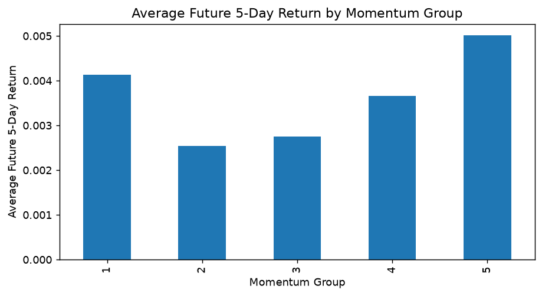
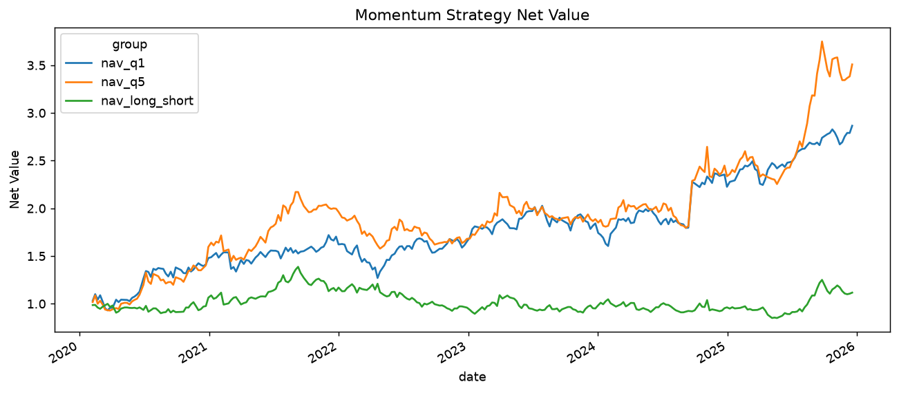

# CSI 300 Momentum Factor Research

A股价格动量因子的横截面检验与分层回测。使用 Python / pandas / AKShare 构建本地行情研究流程，比较5、10、20、60日动量对未来收益的解释能力。

**结论：本样本未观察到稳定的正向横截面动量效应。** 20日动量 Mean RankIC 为 -0.0152，ICIR为 -0.0718，Q5−Q1 的简化回测 Sharpe 为0.198，最大回撤为−38.69%。这是一项保留负面结果和方法局限的研究，不是实盘策略。

## 数据与研究范围

- 股票池：**2026-09-04的沪深300成分股快照**，用该股票池回溯2020–2025，存在幸存者/前视选样偏差。
- 本地数据：416,388条记录，300只股票；2020-01-02至2025-12-31；无code-date重复、无字段缺失。
- 原下载代码：AKShare `stock_zh_a_hist_tx` 腾讯行情接口，`adjust="hfq"`。复权来源按原代码记录，未独立复核供应商复权序列。
- 字段：date、code、open、close、high、low、volume、turnover、amount。量额字段单位未独立核验，本研究仅使用date、code、close。
- 20日因子有效样本为299只股票；短历史股票无法构造完整因子/标签。具体记录可在notebook中查看。
- 冻结CSV纳入仓库；约11.4 MiB的Parquet仅保留本地。数据SHA-256记录于[原始文件清单](docs/original_manifest.json)。

## 研究流程

1. 成分股CSV → 股票行情下载/缓存 → Parquet。
2. 单股票与五股票原型：检查数据、计算收益和动量、理解IC与RankIC。
3. 正式研究：`close_t / close_(t-N) - 1`，标签为单股后5条记录的收盘价收益。
4. 每日横截面Spearman RankIC；ICIR = IC均值/IC标准差，不年化。
5. 每日按因子从低到高等数量五分组，同值按股票排序打破；比较Q1–Q5平均未来收益。
6. 每5个市场观测日期抽样一次，组内等权，Q5−Q1作为简化多空收益；分年份、多窗口及成本压力测试。

## 结果

| 回看窗口 | Mean RankIC | ICIR（未年化） | Sharpe | 最大回撤 |
|---|---:|---:|---:|---:|
| 5日 | -0.0075 | -0.0390 | 0.204 | -30.92% |
| 10日 | -0.0099 | -0.0505 | 0.216 | -29.62% |
| 20日 | -0.0152 | -0.0718 | 0.198 | -38.69% |
| 60日 | -0.0182 | -0.0765 | 0.118 | -53.25% |


20日基准共286个持有期。原代码“Annual Return”为 `(1 + 周期平均收益)^(252/5)-1`，结果 **4.29%**；它不是CAGR。按同样252/5周期换算的几何年化为 **1.96%**（补充指标）。Sharpe假设无风险利率为0。



五组收益不是单调递增。负RankIC与正Q5−Q1可以同时出现，两者分别描述整体排序与极端组差值，不能互相替代。



按信号年份聚合的复合收益：2020：6.42%；2021：9.92%；2022：-17.96%；2023：-0.93%；2024：1.22%；2025：16.03%。这是描述性年份差异，尚未建立市场状态模型。

### 成本敏感性

| 固定成本参数c | 每期扣减 | 年化均值收益 | Sharpe |
|---|---:|---:|---:|
| 5 bps | 10 bps | -0.84% | -0.040 |
| 10 bps | 20 bps | -5.72% | -0.277 |
| 20 bps | 40 bps | -14.77% | -0.752 |


保留原公式：每期Q5−Q1固定扣 `2*c`。c沿用原“单边成本”名称，但此公式没有真实换手率、双腿完整开平仓或借券成本，**仅为固定扣减压力测试**。在最小参数5 bps下，年化均值收益已转负。

## 项目结构

```text
notebooks/
  01_single_stock_and_small_universe_prototype.ipynb
  02_download_and_cache_csi300.ipynb
  03_csi300_momentum_factor_research.ipynb
src/
  data.py                 # 优先使用冻结本地行情
  run_notebooks.py        # 独立进程按单元顺序执行
data/raw/                 # 冻结CSV；Parquet被Git忽略
data/processed/           # IC、回测、年份、稳健性、成本结果CSV
figures/                  # 已重跑导出的6张图
docs/                     # 文件映射、哈希、复现说明
archive/originals/        # 仅本地：原始文件及原notebook输出
README.md
requirements.txt
.gitignore
```

## 复现

验证环境为Windows、Python 3.14.3，直接依赖版本见requirements.txt。这不是从零安装验证过的完整依赖锁文件。

```powershell
python -m venv .venv
.\.venv\Scripts\python.exe -m pip install -r requirements.txt
.\.venv\Scripts\python.exe src/run_notebooks.py
```

推荐通过编辑器的Jupyter支持选用该虚拟环境打开notebook。项目根目录或notebooks目录均可定位数据。

- **有本地数据**：以上命令按01→02→03执行；下载notebook命中缓存，不改写原CSV/Parquet。
- **GitHub新克隆**：先单独运行02下载，再运行全部流程：`python src/run_notebooks.py notebooks/02_download_and_cache_csi300.ipynb`。需访问行情接口；失败代码会报告，存在失败时拒绝保存不完整面板。供应商限流、复权修订等会影响重现，联网全量下载本次未测试。
- **精确重现本次结果**：使用与清单哈希一致的本地Parquet；重新请求供应商不保证逐字节或逐数值一致。
- 执行器重写整理版notebook输出与派生图表/CSV；初始原始notebook及输出另存archive，且桌面源项目保持不变。

详情见[文件用途与重命名映射](docs/file_inventory.md)及[验证记录](docs/validation.md)。

## 局限与下一步

历史成分股、可交易成交时点与统一交易日历是优先改进项。当前按单股后5条记录计算标签，停牌可能使持有期超过5个统一交易日，因此每5日抽样并不保证所有股票收益窗口严格非重叠。信号与入场同用当日收盘价，不能视为可执行交易。

分组前删除未来收益缺失样本会造成未来可得性筛选；IC标签重叠，未作显著性检验或独立样本推断；不同回看窗口起始日及调仓相位不同。回撤按原公式未纳入起始净值1；年份按信号日划分。未控制行业、市值、Beta、波动率或流动性；未计停牌、涨跌停、冲击、真实换手及融券可行性。后续应先修正这些假设，再考虑中性化、多因子及严格样本外验证。
