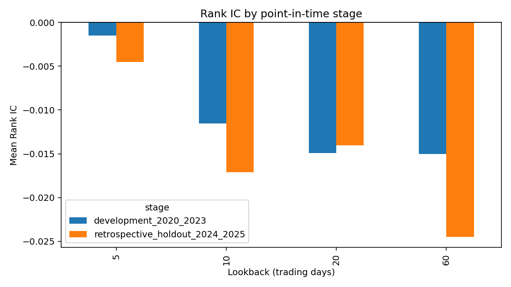
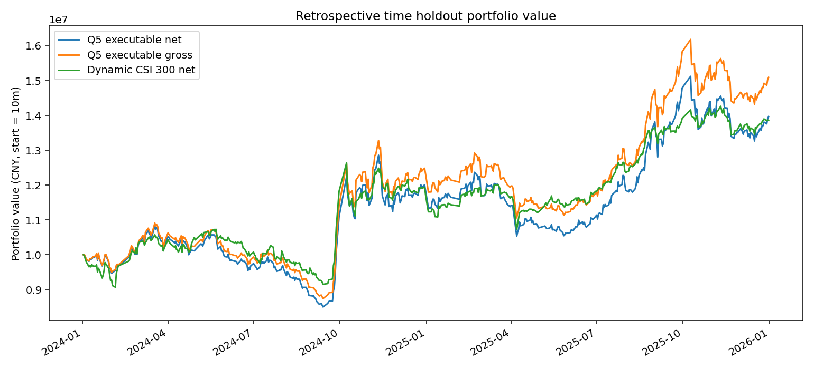
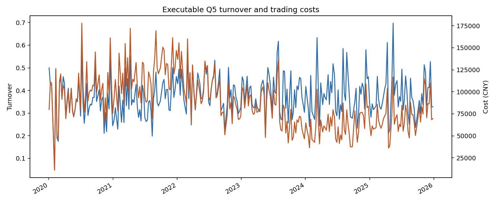

# CSI 300 Momentum Factor Research

沪深300价格动量因子的横截面检验与可执行长仓回测。项目保留最初基于当前成分股的研究，并新增三项正式检验：

1. **按历史时点重建股票池**，不再用 2026 年成分股回溯 2020–2025。
2. **时间外验证区间**，2020–2023 为开发期，2024–2025 为回溯性时间外验证期。
3. **加入交易约束**，信号收盘后生成、下一交易日开盘执行，并处理停牌、涨跌停、ST、成交容量、换手与成本。

**结论：历史股票池和时间外验证修正后，20 日动量仍未显示稳定正向选股能力。** 开发期 Mean RankIC 为 -0.0149（194 个截面），回溯性时间外验证为 -0.0140（96 个有已实现收益的截面，描述性 t 检验 p=0.524）。时间外长仓 Q5 扣成本后总收益 39.74%，比同期动态沪深300等权净基准高 2.57 个百分点，但 Sharpe 更低且回撤更大。这不是可交易 alpha 的证明。

## 数据与股票池

- 行情与历史成分来源：Baostock；行情为后复权日线，研究区间 2020-01-02 至 2025-12-31。
- 在每 5 个交易日的研究截面上，用 `query_hs300_stocks(date=signal_date)` 获取当日历史成分，291 个快照均恰好包含 300 个唯一代码。
- 历史成员并集为 **481 只**，其中 **193 只已不在** 2026-09-04 当前成分快照中；另有 12 只当前成分在研究期结束后才进入股票池。若继续只使用当前 300 只股票，仍存在幸存者偏差。
- 历史行情面板为 731,507 行，date-code 无重复，OHLC 与前收盘无缺失。87,300 个成员日中只有 1 个同日无行情，已按不可交易处理。
- 每次截面只使用信号日当时已知的信息：历史成员、至少 120 个可交易观察日、20 日平均成交额不低于 3,000 万元、信号日可交易且非 ST。下一交易日能否成交不在分组前预筛，而由交易引擎阻塞并记录。
- 下载缓存复用前会校验成员快照日期与 300 行唯一代码，以及行情日期、字段、代码和重复键，避免长期复用半截文件。

原始当前成分数据继续保留在 `data/raw/csi300_constituents.csv`；历史研究使用 `data/raw/csi300_historical_membership.csv` 和 `data/raw/csi300_prices_historical.parquet`。数据生成时间和 SHA-256 见 [历史数据清单](data/raw/historical_dataset_manifest.json)，完整性检查见 [data_quality.json](data/processed/advanced/data_quality.json)。

## 研究设计

### 因子

- 动量：`close_t / close_(t-N) - 1`，N 取 5、10、20、60 个统一交易日。
- 主因子：20 日动量。该选择沿用原研究，不在时间外验证结果上重新挑窗口。
- 标签：信号日下一交易日开盘到第 5 个持有交易日开盘的收益，避免用信号日收盘价成交。
- 每个五日截面计算 Spearman RankIC、五等分未来收益及 Q5−Q1 研究差值。

### 样本拆分与解释边界

- 2020-01-02 至 2023-12-29：开发期，仅用于理解因子与冻结方案。
- 2024-01-02 至 2025-12-31：回溯性时间外验证期。原项目代码和 Git 历史已经包含该区间的收益，因此不能称为事先冻结、从未查看的锁定 OOS。
- 本次只修正未来收益缺失影响分组、执行账户和文档口径；未根据该区间结果重新选择因子方向、回看窗口、持仓数或成本模型。

### 可执行回测

- 主策略只做多 Q5，每 5 个交易日调仓，组内等权。
- 个股融券在 A 股并非通常可得，因此个股 Q5−Q1 只保留为研究诊断，不假定可执行。
- 信号在收盘后生成，订单在下一交易日开盘处理。
- 停牌或开盘接近涨停时不买入；停牌或开盘接近跌停时不卖出，头寸保留并记录阻塞原因。
- 主板涨跌停按 10%、科创板 20%、创业板 2020-08-24 前 10% 之后 20%、ST 5% 判断，开盘价阈值留 20 bps 价格舍入缓冲。
- 初始资金 1 亿元；单笔交易不超过 20 日平均成交额的 5%。
- 佣金 3 bps、每笔最低 5 元，滑点 5 bps；卖出印花税 2023-08-28 前 10 bps、之后 5 bps。
- 动态基准为同一历史股票池、同一流动性过滤和成本约束下的等权组合。

## 主要结果

### RankIC

| 阶段 | 回看窗口 | Mean RankIC | ICIR | 截面数 |
|---|---:|---:|---:|---:|
| 开发期 2020–2023 | 5日 | -0.0015 | -0.0086 | 194 |
| 开发期 2020–2023 | 20日 | -0.0149 | -0.0762 | 194 |
| 开发期 2020–2023 | 60日 | -0.0150 | -0.0689 | 194 |
| 时间外验证 2024–2025 | 5日 | -0.0045 | -0.0218 | 96 |
| 时间外验证 2024–2025 | 20日 | -0.0140 | -0.0652 | 96 |
| 时间外验证 2024–2025 | 60日 | -0.0245 | -0.0950 | 96 |

20 日动量在开发期和时间外验证中均为负 RankIC。时间外验证的 t 统计量为 -0.64、p=0.524，不能支持稳定正向动量；同样也没有足够证据把小样本负值解释成稳定反转因子。



### 回溯性时间外可执行长仓

| 组合 | 总收益 | CAGR | Sharpe | 最大回撤 | 单次平均单边换手 |
|---|---:|---:|---:|---:|---:|
| Q5 毛收益 | 51.00% | 23.88% | 0.998 | -19.87% | 38.2% |
| Q5 扣成本 | 39.74% | 18.99% | 0.833 | -21.47% | 38.1% |
| 动态沪深300等权净基准 | 37.16% | 17.84% | 0.920 | -15.20% | 1.7% |

时间外毛收益到净收益损失约 11.3 个百分点，总交易成本约 648 万元。Q5 扣成本总收益高于基准 2.57 个百分点，但 Sharpe 更低、最大回撤更深，而同一时期 RankIC 仍为负；该差值不足以作为动量有效的证据。





全区间 Q5 扣成本 CAGR 为 +0.54%，动态等权净基准为 +4.97%。完整绩效、阻塞订单和交易日志分别见 `data/processed/advanced/executable_performance.csv`、`rebalance_log.csv` 和 `trade_log.csv.gz`。

## 与初始研究的差异

初始 notebook 的 20 日 Mean RankIC 是 -0.0152，但使用 2026 年股票池回溯 2020–2025，信号与成交都取当日收盘，并只做固定成本扣减。新增研究修正了股票池、执行时点和交易状态，因此结果不能与旧版本逐项混用。

旧 notebook 和旧结果仍然保留，用于展示研究迭代；正式结论以 `data/processed/advanced/` 为准。

## 项目结构

```text
notebooks/
  01_single_stock_and_small_universe_prototype.ipynb
  02_download_and_cache_csi300.ipynb
  03_csi300_momentum_factor_research.ipynb
  04_point_in_time_holdout_and_execution.ipynb
src/
  data.py                          # 初始研究缓存读取
  run_notebooks.py                 # notebook 顺序执行器
  build_historical_dataset.py      # 历史成分与行情下载、缓存、校验
  advanced_research.py             # 分阶段因子检验与可执行长仓回测
tests/test_advanced_research.py    # 标签、成本、涨跌停、NAV和缓存测试
data/raw/
  csi300_historical_membership.csv
  csi300_prices_historical.parquet
  historical_dataset_manifest.json
data/processed/advanced/           # RankIC、绩效、净值、交易与数据质量
figures/                           # 初始研究与新增研究图表
docs/                              # 文件映射、复现和审计记录
```

## 复现

当前历史数据结果复核环境为 Windows、Python 3.13.9；直接依赖见 `requirements.txt`，通过验证的版本集合见 `requirements-advanced.lock`。原始 notebook 另有 Python 3.14 验证记录。

```powershell
python -m venv .venv
.\.venv\Scripts\python.exe -m pip install -r requirements.txt

# 首次使用或强制校验历史股票池时运行；已有逐日/逐股票缓存会自动续跑。
.\.venv\Scripts\python.exe src/build_historical_dataset.py --workers 4

# 根据冻结历史数据重跑开发期、回溯性时间外验证、交易约束和图表。
.\.venv\Scripts\python.exe src/advanced_research.py
```

Baostock 并发会话过多会被限流，建议不超过 4 个 worker。下载器不会用当前成分补缺；任一历史快照不是 300 个唯一成员时会直接失败。供应商可能修订历史数据，因此精确重现应以清单中的 SHA-256 为准。

## 仍然存在的限制

- 历史成分在五日调仓截面取样，与交易决策日一致，但没有逐日保存成员快照；若需研究日频非调仓交易，应补齐逐日成员。
- Baostock 的历史成分与行情是供应商重建数据；已按查询日期取数并做完整性检查，但无法独立证明所有历史修订。
- 回测使用后复权合成单位，因此没有模拟 A 股 100 股整手、红利税、买卖盘口深度、永久冲击成本及融资成本。
- 涨跌停只检查开盘价和 20 bps 容差，没有逐笔订单簿，也没有模拟排队和开板后的部分成交。
- 仍未控制行业、规模、Beta、波动率和流动性因子暴露，也没有做中性化；动态等权基准不等同于正式沪深300指数。
- 回溯性时间外验证只有 96 个有已实现收益的五日截面和两年市场环境，不足以证明跨市场状态稳定。

这些限制意味着结果适合作为因子研究和方法迭代材料，不应作为实盘交易建议。
